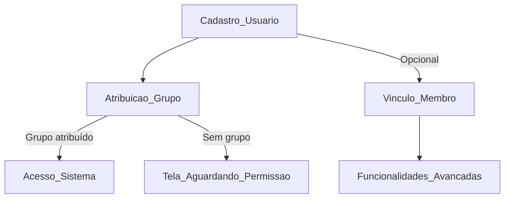

# Documentação de Permissões e Fluxo de Usuários – Gereigreja

## 1. Conceitos-Chave

- **Usuário**: Conta de acesso ao sistema (Django User).
- **Membro**: Pessoa cadastrada na secretaria, pode ou não ter acesso ao sistema.
- **Vínculo Usuário ↔ Membro**: Relacionamento opcional (OneToOneField) entre User e Membro.
- **Grupo/Papel**: Define permissões e acesso ao sistema (ex: Admin Ministerio, Pastor Local).

## 2. Fluxo de Cadastro e Onboarding

1. **Criação do Usuário**
   - Cadastro via onboarding, admin ou convite.
   - Obrigatório: nome, e-mail, senha.
2. **Atribuição de Grupo/Papel**
   - Usuário deve ser adicionado a pelo menos um grupo para acessar o sistema.
   - Exemplo: "Admin Ministerio" garante acesso total.
3. **(Opcional) Vínculo com Membro**
   - Recomenda-se vincular o usuário a um membro para funcionalidades avançadas (secretaria, relatórios, notificações).
   - Não é obrigatório para acesso básico.

## 3. Controle de Acesso

- **Permissão de acesso**: Controlada por grupos/papéis (Django Groups).
- **Usuário sem grupo**: Redirecionado para tela "Aguardando Configuração de Permissões".
- **Usuário com grupo**: Tem acesso ao sistema conforme permissões do grupo.
- **Vínculo com membro**: Opcional, mas pode ser necessário para relatórios, secretaria, integração de dados pessoais.

## 4. Hierarquia de Grupos (contas/constants.py)

- Grupos principais:
  - Admin Ministerio (acesso total)
  - Pastor Regional
  - Pastor Local
  - Operacional
  - Equipes
  - Membro Comum
- Funções utilitárias:
  - `user_tem_grupo(user, nome_grupo)`
  - `user_tem_qualquer_grupo(user, lista_grupos)`
  - `user_has_permission_level_or_higher(user, required_group)`

## 5. Recomendações e Boas Práticas

- Sempre atribua um grupo ao criar um novo usuário.
- Vincule o usuário a um membro se desejar integração com secretaria ou relatórios personalizados.
- Use os grupos definidos em `contas/constants.py` para evitar erros de permissão.
- Documente e treine os administradores para revisar permissões periodicamente.

## 6. Resumo Visual do Fluxo

## 7. Pontos de Atenção

- O vínculo "Membro da Equipe" não é obrigatório para acesso, mas pode ser exibido no admin para referência.
- O acesso bloqueado (tela cinza) geralmente ocorre por falta de grupo, não por falta de vínculo com membro.
- Para liberar acesso total, basta garantir que o usuário está no grupo "Admin Ministerio".

---

*Esta documentação deve ser revisada e atualizada conforme evoluções do sistema e das regras de negócio.*
